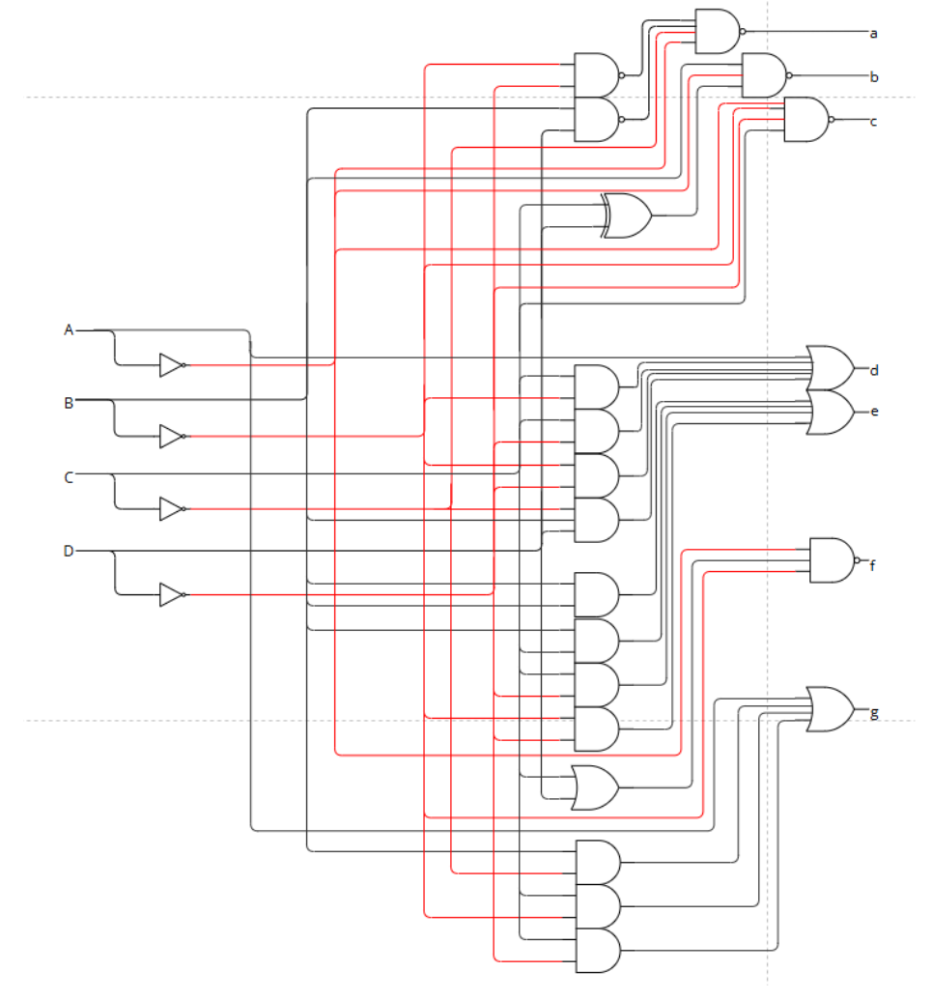

# 7세그먼트 시계와 타이머

현재 시각과 실행 후 경과 시간을 터미널에 7세그먼트 숫자로 표시하는 C 프로그램입니다. 각 십진수 자리를 4비트로 바꾸고, 논리식으로 세그먼트 7개를 켤지 결정합니다. 켜진 세그먼트를 `_`와 `|`로 그려 한 숫자를 세 줄로 표시합니다.

## 빌드와 실행

macOS나 Linux 터미널의 저장소 루트에서 실행합니다. `cc`로 C 소스를 빌드합니다.

```sh
mkdir -p build
cc -std=c11 -Wall -Wextra src/main.c -o build/7segment-clock
./build/7segment-clock
```

화면은 약 1초마다 갱신됩니다. 타이머는 `00:00:01`부터 표시되며, `Ctrl+C`로 종료합니다.

## 코드 흐름

| 함수 | 역할 |
| --- | --- |
| `main` | 시스템의 현재 시각을 읽고 경과 시간을 갱신한 뒤, 두 값을 출력합니다. |
| `sep_hextobin` | 시·분·초의 각 자리를 4비트로 나눠 `logic`에 전달하고 숫자 여섯 자리를 줄 단위로 출력합니다. |
| `logic` | 4비트 입력으로 세그먼트 각 위치의 출력 여부를 계산해 숫자 한 자리의 세 줄을 만듭니다. |

세 함수는 [원본 C 소스](src/main.c)에 들어 있습니다.

## 회로 로직

십진수 한 자리(0~9)를 4비트 `ABCD`로 입력합니다. `A`가 최상위 비트(8), `D`가 최하위 비트(1)입니다. 출력 `a`~`g` 중 값이 1인 세그먼트를 켭니다.

```text
   a
 f   b
   g
 e   c
   d
```

`logic`은 아래 C 논리식으로 각 출력을 계산합니다. `!`는 NOT, `&&`는 AND, `||`는 OR, `^`는 XOR입니다. 예를 들어 숫자 2(`0010`)를 입력하면 `a`, `b`, `d`, `e`, `g`가 켜집니다.

```c
bool a = !(!A && !C && !(B && D) && !(!B && !D));
bool b = !(!A && B && (C ^ D));
bool c = !(!(A) && !(B) && C && !(D));
bool d = A || (C && !B) || (C && !D) || (!B && !D) || (B && D && !C);
bool e = (A && B) || (A && C) || (C && !D) || (!B && !D);
bool f = !(!A && !B && (C || D));
bool g = A || (B && !C) || (C && !B) || (C && !D);
```

아래 회로도는 [구현 발표 PDF](docs/presentation.pdf) 3쪽에서 가져왔습니다. 왼쪽의 `A`~`D`가 입력이고 오른쪽의 `a`~`g`가 출력입니다.



## 프로젝트 자료

| 파일 | 내용 |
| --- | --- |
| [기획안 PDF](docs/proposal.pdf) | 7세그먼트의 개념과 구현 계획 |
| [구현 발표 PDF](docs/presentation.pdf) | 논리회로도, 알고리즘 흐름, C 함수 설명 |
| [시연 영상 MOV](demo/clock-demo.mov) | 터미널에서 현재 시각과 타이머가 갱신되는 모습 |
